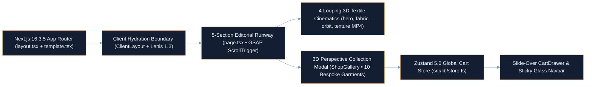

<div align="center">

# THREADLAB — Digital Haute Couture & Interactive Fashion Atelier

**Next.js 16 App Router Showroom with 3D-Rendered Textile Cinematics, GSAP ScrollTrigger & Lenis Inertial Choreography**

<p align="center">
  <a href="https://ayan-ai-engineer.vercel.app"></a>
  <a href="package.json"></a>
  <a href="netlify.toml"></a>
  <a href="https://github.com/Ayan-Rajput-Analysis/threadlab"></a>
</p>

</div>

---

## Executive Summary

> **Governing Mandate:** Architect an editorial digital fashion platform that fuses 3D-rendered looping textile cinematics, inertial scroll physics, and CSS 3D perspective commerce interactions inside a Next.js 16 and React 19 server/client architecture.

- **Inertial Scroll & GSAP Choreography:** Couples **Lenis `1.3.26`** momentum scrolling with **GSAP `3.15` (`ScrollTrigger`)** split-typography reveals ([`AnimatedText.tsx`](src/components/shared/AnimatedText.tsx)), scroll-scrubbed `1.3x` textile video zoom, and 5 multi-palette editorial chapters (`#0A0A0A` Obsidian, `#F5EDE0` Linen, `#0A1628` Deep Navy, `#1A1410` Espresso).
- **CSS 3D Perspective Atelier & Reactive Cart:** Engineers a full-screen 10-garment bespoke suit showcase ([`ShopGallery.tsx`](src/components/shared/ShopGallery.tsx), `` `$1,200` ``–`` `$2,550` ``) featuring `perspective: 1200px` / `transform-style-3d` card choreography (`rotationX` GSAP stagger) wired to a zero-re-render **Zustand `5.0`** slide-over cart ([`CartDrawer.tsx`](src/components/shared/CartDrawer.tsx)).
- **Production Edge Caching & Hardening:** Configures [`netlify.toml`](netlify.toml) with `@netlify/plugin-nextjs`, 1-year `immutable` edge caching (`max-age=31536000`) across `/frames/*` and `/_next/static/*`, and strict `X-Frame-Options: DENY` and `X-Content-Type-Options: nosniff` headers.

---

## System Architecture



---

## Capabilities & Case Study Matrix

| Chapter / Module | Source Artifact | Visual Palette & Motion Telemetry | Quantified Spec |
| :--- | :--- | :--- | :--- |
| **00 // The Silhouette (Hero)** | [`src/app/page.tsx`](src/app/page.tsx) | `#0A0A0A` obsidian backdrop + `/videos/hero.mp4` 3D mannequin loop + GSAP scroll-fade | Full `100vh` kinetic split-text entrance |
| **01 // The Craft** | [`src/app/page.tsx`](src/app/page.tsx) | `#F5EDE0` warm linen + `#2A1810` espresso type + `/videos/fabric.mp4` ripple showcase | `500+` manufacturers • `40+` countries • `10K+` designs |
| **02 // The Collection (Portfolio)** | [`src/app/page.tsx`](src/app/page.tsx) | `#0A1628` deep navy + `#D4A853` gold accents + `/videos/orbit.mp4` 3D dress orbit | 3 interactive `UiverseCard` couture pillars |
| **03 // The Detail (Process)** | [`src/app/page.tsx`](src/app/page.tsx) | `#1A1410` espresso + `/videos/texture.mp4` with GSAP `1.0x -> 1.3x` scroll-scrubbed zoom | 4-stage pipeline (`Design -> Prototype -> Manufacture -> Deliver`) |
| **04 // Interactive Atelier Shop** | [`src/components/shared/ShopGallery.tsx`](src/components/shared/ShopGallery.tsx) | `perspective: 1200px` 3D grid, `rotationX: 15 -> 0` `back.out(1.2)` stagger & `data-lenis-prevent` lock | **10 bespoke suits** (`Suit Collection No. 1–10`, `` `$1,200` ``–`` `$2,550` ``) |
| **05 // Reactive Cart Drawer** | [`src/components/shared/CartDrawer.tsx`](src/components/shared/CartDrawer.tsx) | Slide-over glassmorphic bag synced via Zustand selector subscriptions (`totalItems`) | Instant add/remove/quantity state with zero prop drilling |

---

## QA & Engineering Verification

- **Lenis + Modal Scroll Isolation:** [`ShopGallery.tsx`](src/components/shared/ShopGallery.tsx) applies `data-lenis-prevent="true"` and deterministic root overflow locking/cleanup so modal browsing never leaks scroll momentum to the underlying GSAP ScrollTrigger runway.
- **Memory-Safe GSAP Lifecycle:** All `ScrollTrigger` instances registered in [`src/app/page.tsx`](src/app/page.tsx) execute deterministic `trigger.kill()` teardown on component unmount.
- **Accessibility & Motion Ergonomics:** Custom hooks (`src/hooks`) and semantic landmarks support `prefers-reduced-motion`, high-contrast editorial typography, and Next.js `next/image` responsive optimization across all 10 collection assets.
- **Edge Deployment Configuration ([`netlify.toml`](netlify.toml)):** Enforces `Cache-Control: public, max-age=31536000, immutable` on static frame/bundle directories alongside `X-Frame-Options: DENY`, `X-Content-Type-Options: nosniff`, and `Referrer-Policy: strict-origin-when-cross-origin`.

---

## Tech Stack & Reproducible Quickstart

<p align="left">
  
  
  
  
  
  
  
  
</p>

### Repository Structure

```text
threadlab/
├── public/
│   ├── videos/                      # 4 looping 3D textile cinematics (hero, fabric, orbit, texture)
│   ├── images/                      # 10 curated bespoke garment assets (suit_1.jpg – suit_10.jpg)
│   └── frames/                      # Immutable cached sequence assets
├── src/
│   ├── app/                         # Next.js 16 App Router (layout.tsx, page.tsx, template.tsx)
│   ├── components/
│   │   ├── layout/                  # Navbar.tsx, SmoothScroll.tsx (Lenis), ClientLayout.tsx
│   │   ├── shared/                  # AnimatedText.tsx, ShopGallery.tsx, CartDrawer.tsx, FadeIn.tsx
│   │   └── ui/                      # ShopTriggerButton.tsx, UiverseButton.tsx, UiverseCard.tsx
│   ├── hooks/                       # Motion preference & viewport hooks
│   ├── lib/                         # constants.ts, fonts.ts, metadata.ts & Zustand store.ts
│   └── styles/                      # Tailwind CSS v4 LightningCSS design tokens
├── netlify.toml                     # Immutable cache headers & security configuration
├── next.config.ts                   # Next.js 16 configuration
└── package.json                     # Verified dependency manifest
```

### Local Execution

```bash
# 1. Clone the repository
git clone https://github.com/Ayan-Rajput-Analysis/threadlab.git
cd threadlab

# 2. Install dependencies (Node.js 20+ recommended for Next.js 16)
npm install

# 3. Launch development server
npm run dev
# Visit http://localhost:3000

# 4. Build & verify production bundle
npm run build
npm run start
```

---

<div align="center">

**[Live Author Portfolio (`ayan-ai-engineer.vercel.app`)](https://ayan-ai-engineer.vercel.app)** &nbsp;•&nbsp; **[LinkedIn](https://www.linkedin.com/in/ayan-rajput-8781a7397/)** &nbsp;•&nbsp; **[Email](mailto:ayanrajput779900@gmail.com)**

<sub>Architected &amp; Engineered by <a href="https://github.com/Ayan-Rajput-Analysis"><strong>Ayan Rajput</strong></a> • AI &amp; Deep Learning Engineer | 3D WebGL Specialist | Full-Stack &amp; BI Architect</sub>

</div>
